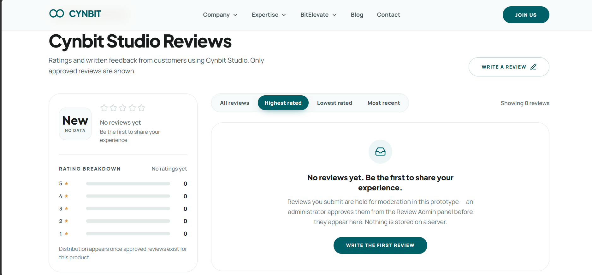
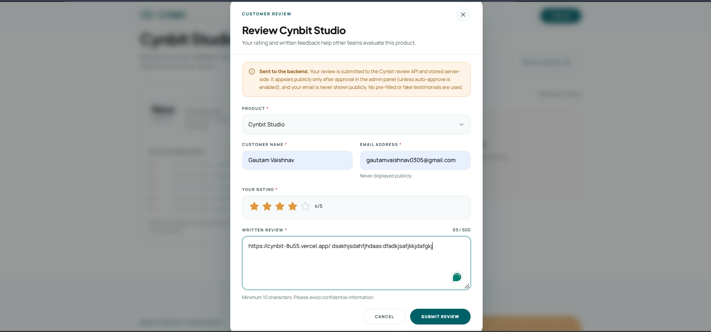
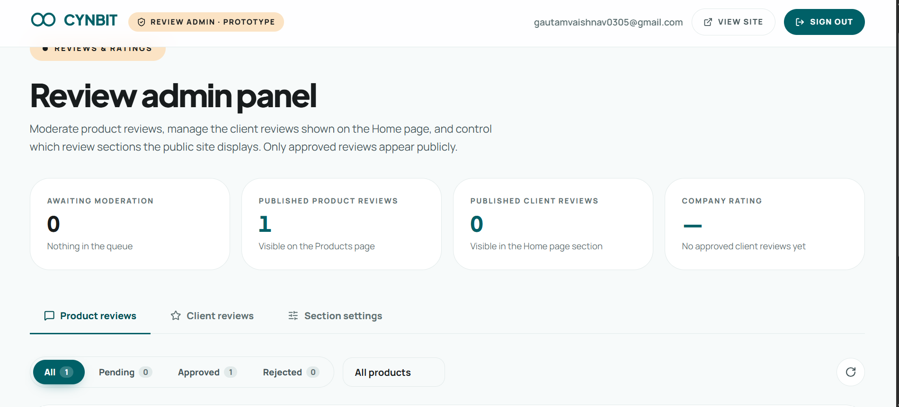
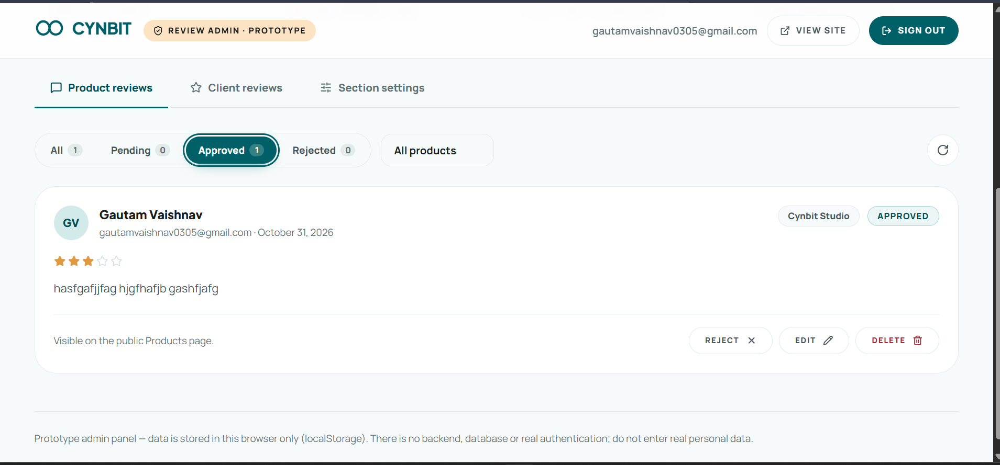
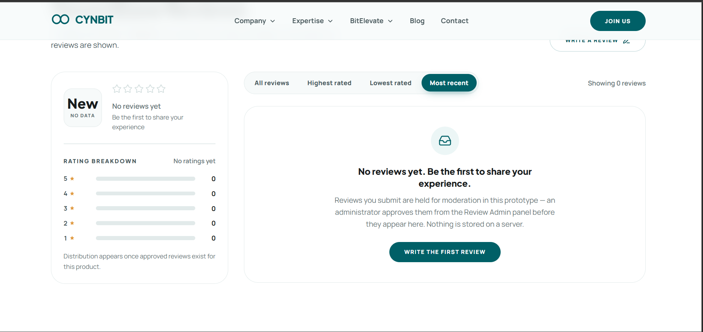

# Website Upgrade Proposal — Cynbit Technologies
### What changed on the existing website, and why it's worth it

**Prepared for:** Cynbit Technologies (owner review)
**Prepared by:** Engineering
**Subject:** Upgrading `cynbit.in` — adding a Reviews & Ratings system, a Client-Reviews (social-proof) section, and a self-serve Admin panel
**Status:** Working prototype, ready to demo · No risk to the live site

---

## 1. TL;DR (30-second version)

The current `cynbit.in` is a strong **brochure** — it explains who Cynbit is and what it builds. But it has three gaps that cost us leads and trust:

1. **No product reviews on the products page** — visitors evaluating Cynbit Studio / TenantEase / Revio have no on-site social proof to help them decide.
2. **No "what clients say about Cynbit" section** — the company's reputation lives on Google/Clutch, not on our own site where the decision happens.
3. **No way for the team to manage any of it** — every change needs a developer.

We built a **working prototype** of the upgraded site (same look and feel) that adds:

- ⭐ **Product Reviews & Ratings** — star ratings, review counts, 5→1 breakdown, and a "Write a review" form on each product.
- 🗣️ **Client Reviews of Cynbit** — a trust-building section on the home page showing real customer ratings of the company.
- 🛠️ **Admin Panel** — a simple back-office to approve reviews, add client testimonials, and switch sections on/off — no developer needed.

> **Important honesty note:** The prototype ships with **zero** fabricated reviews. It starts empty and stays empty until real reviews are entered. We will never invent star ratings or testimonials — that would be a legal and reputational risk. Everything you see in the demo is either real data someone typed in, or an honest "No reviews yet" state.

---

## 1.5 🎬 Watch the 2-minute demo

A recorded walkthrough of the upgraded site — the new reviews, the client-reviews section, and the admin panel in action.

<video controls width="100%" preload="metadata">
  <source src="videos/demo-recording.mp4" type="video/mp4" />
  Your browser does not support embedded video.
</video>

> **Playback tip:** If the video does not play inline in your Markdown viewer, open [`docs/videos/demo-recording.mp4`](videos/demo-recording.mp4) directly, or drag it into a browser tab. The file is ~91 MB.

**What the demo shows:**
1. The recreated home & products pages (same look as the live site).
2. The new **Reviews & Ratings** section on a product — stars, breakdown, "Write a review".
3. Submitting a review → it waits for approval (proving nothing auto-publishes).
4. The **Client Reviews** trust section on the home page.
5. The **admin panel** — approving a review and toggling sections on/off.

---

## 2. Why build this on the existing website? (The business case)

### 2.1 The problem we're solving

| Today on cynbit.in | What it costs us |
| --- | --- |
| Products page shows features but **no customer ratings** | Visitors have to leave the site (Google, Clutch, social) to judge trust — and many don't come back. |
| No on-site client testimonials of the company | We're asking visitors to take our word for it, instead of letting happy customers do the selling. |
| No review collection mechanism | We likely *have* satisfied customers, but there's no pipeline to turn that into on-site proof. |
| Any content change needs a developer | Slow, expensive, and blocks small updates like publishing a review. |

### 2.2 Why it's helpful (the return)

- **More trust → more demo requests.** Social proof (real ratings + reviews) is the single highest-leverage addition to a products/decision page. It reduces the perceived risk of contacting sales.
- **We own the narrative.** Instead of hoping prospects find good reviews elsewhere, curated client reviews sit right next to the "Schedule a Demo" button.
- **It's self-serve.** Marketing/team can publish or moderate reviews in seconds from the admin panel — no dev cycle, no deploy.
- **It's honest and defensible.** Because the system starts empty and only shows *approved* reviews, everything published is real and vetted. That protects the brand.
- **Low risk to try.** This is a **prototype layered on top of the existing design** — it doesn't touch the live site. We can demo it, decide, and only then invest in the backend.

### 2.3 Why a prototype first (senior-engineer reasoning)

- **De-risk before spending.** We prove the UX and the value *before* committing backend/budget.
- **The design is already matched** — same colors, fonts, spacing, buttons, and layout as the live site, so what you see is exactly how the real thing would look.
- **Backend is already planned.** The frontend is written against a documented API contract (`JSON.md`), so wiring a real database later is a mechanical swap, not a rebuild.

---

## 3. What's new vs. what's unchanged

### 3.1 Unchanged (faithfully recreated from the live site)

- Home, Products, Case Studies, and Contact pages — same structure, copy, colors, typography, gradients, buttons, spacing.
- Header, navigation, footer, logo, and overall brand look.
- Responsive behaviour (desktop / tablet / mobile) and accessibility basics.

> The existing site's content and design are respected. This is an **additive** upgrade, not a redesign.

### 3.2 Added (the new value)

| # | Feature | Where it appears | What it does |
| --- | --- | --- | --- |
| 1 | **Product Reviews & Ratings** | Products page — under each product | Average stars, approved-review count, 5→1 star breakdown, sortable review list, and a "Write a review" modal form. |
| 2 | **Client Reviews of Cynbit** | Home page — new section | The company's overall average rating + approved customer reviews (name, role, stars, quote, source like "Google"). |
| 3 | **Admin Panel** | `/admin` (linked discreetly in the footer) | Approve/reject/edit/delete reviews, add client reviews, and toggle sections on/off. |

---

## 4. Screenshots (visual proof)

> **Note to presenter:** Images live in `docs/screenshots/` — 5 shots are included below (product reviews, review form, admin dashboard, moderation controls, and the honest empty state).

### 4.1 The upgraded prototype

| Upgraded prototype |
| --- |
|  *(adds star ratings + reviews per product)* |

### 4.2 Screenshot list

| File | What it shows | Status |
| --- | --- | --- |
| `02-new-products-reviews.png` | The new **Reviews & Ratings** section (stars, breakdown, "Write a review"). | ✅ included |
| `05-review-form.png` | The **"Write a review"** modal open (star picker, fields, char counter, backend-submission notice). | ✅ included |
| `06-admin-dashboard.png` | The **admin dashboard** — stats + the three tabs (Product reviews / Client reviews / Section settings). | ✅ included |
| `07-admin-moderation.png` | A submitted review with **Approve / Reject / Edit / Delete** controls. | ✅ included |
| `08-empty-state.png` | The honest **"No reviews yet"** empty state (proves nothing is fabricated). | ✅ included |

### 4.3 New feature detail

#### ⭐ Product Reviews & Ratings (Products page)
- **Average star rating** + **number of approved reviews** per product.
- **5→1 star breakdown** so visitors see the distribution, not just a single number.
- **Sortable list** — All / Highest / Lowest / Most recent.
- **"Write a review" form** — product pre-selected, 1–5 interactive stars, written review with a character counter, inline validation, success/error states.
- **Moderation-aware** — new submissions are held for approval (unless auto-approve is switched on), so nothing publishes unvetted.

#### ✍️ "Write a review" modal

The submission form opens as a focused dialog: product pre-selected, customer name and email (with a "never displayed publicly" note), 1–5 interactive stars, and a written review with a live character counter. When the backend is connected, the notice explains that the review is submitted to the API, held for approval, and that emails are never shown publicly.

#### 🗣️ Client Reviews of Cynbit (Home page)
- Shows the **company's overall average rating** and **approved client reviews** — real customers rating Cynbit as a partner.
- Each card: client name, role/company, star rating, the quote, date, and an optional **source** (e.g. "via Google", "via Clutch") so prospects see the provenance.
- **Admin-entered only** (no public form) — so only genuine, curated customer feedback appears.

#### 🛠️ Admin Panel (`/admin`)
- **Dashboard** — at-a-glance counts: reviews awaiting approval, published product reviews, published client reviews, and the company's average rating.
- **Product reviews tab** — filter by status (All/Pending/Approved/Rejected) and by product; **Approve / Reject / Edit / Delete** each review.
- **Client reviews tab** — add and manage the client testimonials shown on the home page.
- **Section settings tab** — instant switches to show/hide the product-reviews section and the client-reviews section, an auto-approve toggle, and a "reset prototype data" control.

#### ✅ Honest empty state (important)
The prototype ships with **no** reviews and no fake ratings. Empty sections show a clear "No reviews yet — be the first" message instead of invented numbers. This is deliberate: publishing fake testimonials would be misleading and risky.

---

## 5. How it's built (one paragraph for the technical reader)

- **Stack:** React + TypeScript + Vite + Tailwind CSS — modern, fast, easy to hire for.
- **Same design system** as the live site (recreated tokens for color, type, spacing), so it looks native, not bolted on.
- **Backend-ready:** all data operations sit behind documented service modules mapped to a REST API (`JSON.md` — 17 endpoints, database schema, validation rules). Swapping the prototype's local storage for a real database is a contained change.
- **Production-hardened:** SEO/social meta tags, sitemap & robots, SPA routing fallback, an error boundary, and code-splitting (the admin panel loads only when visited). Accessibility and performance were audited.
- **Safe:** runs entirely on a local prototype — the live `cynbit.in` is untouched.

---

## 6. Recommendation & next steps

**Recommendation:** Approve moving from prototype → production for the Reviews & Ratings system and the Client-Reviews section.

| Phase | What happens | Outcome |
| --- | --- | --- |
| **Now** | Demo this prototype, confirm the look and the features. | Shared understanding, no cost. |
| **Next** | Build the backend (per `JSON.md`), add real auth for `/admin`, connect a database. | Reviews persist, admin is secure. |
| **Then** | Seed with *genuine* reviews (from real customers / Google / Clutch), deploy alongside or replacing the current site. | Live social proof driving demo requests. |

**Open questions for the owner:**
1. Do we want reviews **publicly submittable** (any visitor) or **admin-entered only** (curated)? *(The prototype supports both — currently moderation is on.)*
2. Which client reviews can we legitimately publish (and from which source — Google, Clutch, direct)? We'll only publish ones we have permission to use.
3. Should product reviews and client reviews both launch, or start with one?

---

## 7. Honesty & compliance commitment

- **No fabricated data.** The prototype contains zero invented reviews, ratings, or testimonials. Every count and average is computed from real, approved entries.
- **Approved-only publishing.** Nothing appears publicly until approved in the admin panel.
- **Real customer content only.** Before going live, we will only publish client reviews we have obtained permission to use, attributed to their source.
- **No access to private systems.** This prototype was built only from the *publicly visible* website. It does not use Cynbit's private repositories, databases, analytics, or hosting.

---

*This is a working prototype prepared for review. The live website has not been modified. Technical details for engineering are in `README.md` (features) and `JSON.md` (backend API contract).*
